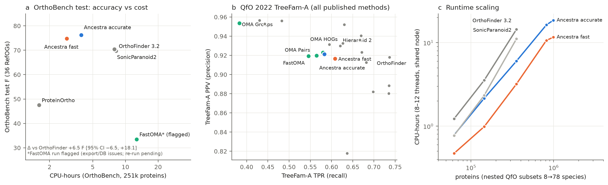

# Ancestra — one-page summary (paused at T+19h30, 2026-10-27 10:10 CET)

**Ancestra** treats orthology as *level-synchronous ancestral-genome reconstruction inside de novo protein families*. It runs in three stages:
1. **S0** partitions all proteins into families in near-linear time (DIAMOND clustering, then all genes vs representatives). No reference orthology database is used and there is no all-vs-all search.
2. **S2** scores protein pairs only within families.
3. **S3** walks the NCBI guide tree bottom-up and merges ancestral genes of all families at each node. It uses mutual-best matches, in-paralog absorption, small FastTree local trees with species-overlap labelling for ambiguous clusters, and an optional gene-order (synteny) re-ranking.

The output is hierarchical orthologous groups (HOGs) in OrthoXML, plus pairs. There are two frozen presets: `accurate` (FastTree, the default) and `fast` (NJ).

## In a nutshell
- **OrthoBench test** (36 held-out RefOGs, one-time evaluation): Ancestra `accurate` scores **F 76.2** against OrthoFinder 3.2 at 69.7 and SonicParanoid2 at 70.4, using **3.9 vs 8.2 CPU-h**. The pre-registered non-inferiority rule is **not met** against OrthoFinder: the 95% CI is too wide, Δ +6.5 [−6.5, +18.1]. Against the **OMA browser HOGs** (All.May2026, precomputed; OMA contains all 12 species) Ancestra is **+15.7 [+1.8, +29.2]** F (OMA 60.4: P 88.9, R 45.8). FastOMA 0.5.1, re-run with a patch for its gene-dropping bug (gene coverage 79.0%→80.6%), scores test F 33.1; Ancestra is **+43.1 [+14.0, +55.3]** F, so the gap is not caused by the bug.
- **QfO 2022** (78 species, ~1M proteins; the full official suite run locally):
  - Ancestra is **non-inferior to FastOMA and OMA Pairs** on TreeFam-A test recall.
  - It is **clearly below OrthoFinder** on recall: TreeFam-A −0.16, SwissTree −0.10.
  - Its species-tree discordance (G-STD2-Euk RF .257) is the worst of the main comparators.
  - EC precision is a little lower, consistent with vertebrate over-merging.
- **Cost and scaling:** one QfO run takes ~1.9 h wall and 11.6 CPU-h (`fast`) or 18.5 CPU-h (`accurate`), with ≤29 GB RAM. On nested QfO subsets, CPU grows about as proteins^1.1, against about proteins^1.4–1.5 for OrthoFinder and SonicParanoid2. At 32 species it costs 3.2–6.0 CPU-h, against 14.4 for OrthoFinder and 11.1 for SonicParanoid2. At 8 species FastOMA takes 1.83 CPU-h against 0.47–0.78 for Ancestra (FastOMA's precomputed OMA database is not counted). Fitted slope for Ancestra: 1.16 [1.10, 1.21]; the competitor fits rest on only 3 points.
- **Extra data layers**, each tested standalone and then in the full pipeline:
  - *Synteny* discriminates orthologs from paralogs well (human–mouse AUC 0.92; shuffled 0.50). Its gain in the frozen merge was dev-only and is **not measurable on the test sets**.
  - *3D structure (3Di; 94.5% QfO coverage from AFDB/Foldcomp)* lifts family completeness above the sequence ceiling (0.853 vs 0.82). It gave no merge gain and is an option only.
  - *Expression (Bgee)* and *isoforms* were killed by pre-registered rules.
  - *Genome DNA* (miniprot at syntenic loci) shows that 53% of apparent mammal losses are not losses: 32% are our own fission errors, and 25% are confirmed pseudogenes or deletions, e.g. GULO and UOX in primates.
- **Species tree:** the NCBI taxonomy guide tree is best. Data-derived trees (ASTRAL-Pro, FastME) are equal on OrthoBench but buy QfO recall at a large EC cost. A random tree costs −16 OrthoBench F (negative control).

**Honesty notes.** 18 protocol deviations are listed in `docs/DISCLOSURES.md`. Among them, the TreeFam-A dev split was created after the first QfO peek, and OrthoBench dev was reused heavily, so dev numbers are optimistic. Every key number was recomputed by an independent agent (`docs/VERIFICATION.md`).

**Not finished at pause:** FastOMA scaling runs, and the 125–1000-proteome scalability demo (data ready, runs not started). Next steps are in `RESUME.md`.
